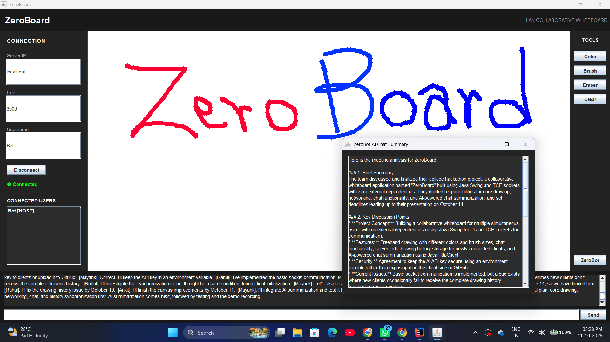
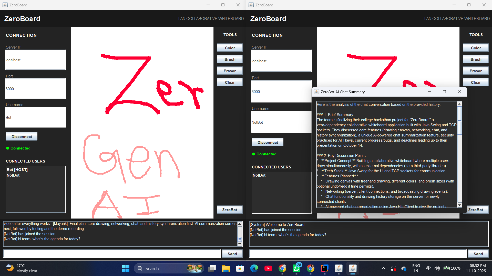
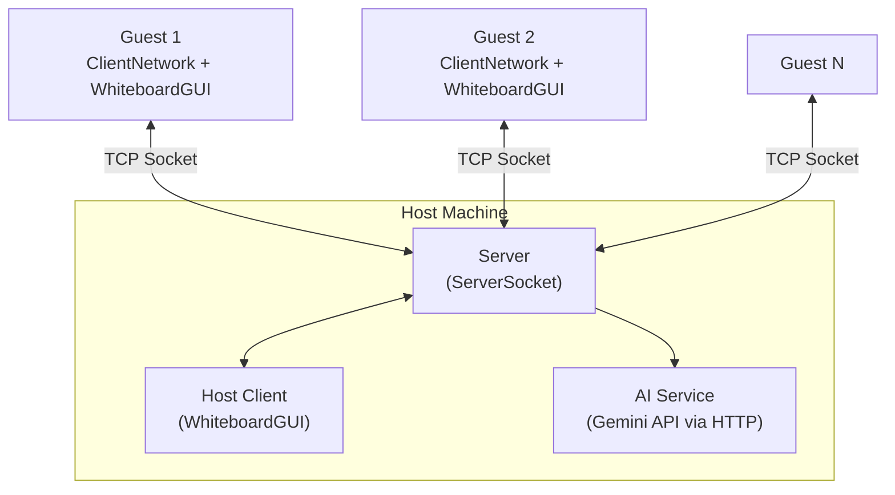

# 🧩 ZeroBoard

### A Real-Time Collaborative LAN Whiteboard with AI-Powered Chat Summarization

*Draw together. Chat together. Turn team discussions into actionable
summaries.*

------------------------------------------------------------------------

## 📖 Overview

**ZeroBoard** is a desktop application for real-time collaboration over
a local network. One user hosts a session, while other users join as
guests to draw on a shared canvas and communicate through group chat.

Built with **Java Swing**, **raw TCP sockets**, and **Java 21 virtual
threads**, ZeroBoard demonstrates client-server networking and
concurrent communication. This updated version also includes
**AI-powered chat summarization**: users can request a summary of the
discussion, including key points, decisions, and action items.

The core networking and GUI use Java's standard library. The AI feature
calls the Gemini API over HTTP and uses **Gson** to parse JSON
responses, so this version is **not strictly zero-dependency** and the
AI feature requires internet access.

------------------------------------------------------------------------

## 🖼️ Screenshots

### Main Interface

### Real-Time Collaborative Drawing

> Ensure these images exist in the repository's `images/` directory, or
> update the paths to match your files.

------------------------------------------------------------------------

## ✨ Features

  ---------------------------------------------------------------------
              Status              Feature            Description
  ------------------------------- ------------------ ------------------
                ✅                **Real-time        Drawing strokes
                                  collaborative      are sent to the
                                  drawing**          server and relayed
                                                     to connected
                                                     participants.

                ✅                **Live group       Participants can
                                  chat**             exchange messages
                                                     in the same
                                                     session.

                ✅                **Host / Guest     The host starts
                                  roles**            the server and
                                                     joins its own
                                                     session; guests
                                                     connect using the
                                                     host's IP address.

                ✅                **Brush controls** Choose a drawing
                                                     color and adjust
                                                     brush thickness.

                ✅                **Eraser**         Erase by drawing
                                                     with the canvas
                                                     background color.

                ✅                **Virtual-thread   Java 21 virtual
                                  concurrency**      threads handle
                                                     client
                                                     connections.

                ✅                **AI chat          Generates a
                                  summarization**    summary of chat
                                                     discussions,
                                                     decisions, and
                                                     action items.

                ✅                **Server-side AI   The server calls
                                  requests**         Gemini, keeping
                                                     API request logic
                                                     out of the client
                                                     UI.

                🚧                **Networked canvas Verify that the
                                  clear**            clear action is
                                                     broadcast to all
                                                     connected clients
                                                     before marking it
                                                     complete.

                🚧                **Undo / Redo**    Treat as in
                                                     progress unless
                                                     history operations
                                                     are fully
                                                     implemented.
  ---------------------------------------------------------------------

------------------------------------------------------------------------

## 🏗️ Architecture

ZeroBoard uses a hub-and-spoke client-server model. The host runs the
central server and also connects as a client, allowing it to use the
same whiteboard and chat features as guests.

-   **Server:** Accepts socket connections and creates a `ClientHandler`
    for each client.
-   **Client handler:** Reads incoming messages and routes them to
    server-side logic.
-   **Broadcasting:** Drawing and chat events are relayed to connected
    clients.
-   **AI summarization:** On request, the server gathers chat history,
    sends a prompt to Gemini, and returns the generated summary to the
    requesting client.
-   **Swing UI:** Displays the canvas, chat, connection controls, and
    summary panel.

------------------------------------------------------------------------

## 📡 Network Protocol

ZeroBoard uses a lightweight text protocol over TCP. Ordinary events use
pipe-delimited fields. Since the receiver uses
`BufferedReader.readLine()`, **each protocol event must be sent as one
line**. Multiline AI JSON must be compacted to a single line before
sending it through the socket.

  ------------------------------------------------------------------------------------------------------
  Event           Format                                        Example
  --------------- --------------------------------------------- ----------------------------------------
  **Draw**        `DRAW\|x1\|y1\|x2\|y2\|colorRGB\|brushSize`   `DRAW\|120\|85\|140\|95\|-16777216\|4`

  **Chat**        `CHAT\|username\|message`                     `CHAT\|Mayank\|Hello everyone`

  **User joined** `USER_JOINED\|username`                       `USER_JOINED\|Mayank`

  **AI summary    `AI_SUMMARIZE`                                `AI_SUMMARIZE`
  request**                                                     

  **AI summary    `AI_SUMMARIZE\|<single-line JSON>`            `AI_SUMMARIZE\|{"candidates":[...]}`
  response**                                                    
  ------------------------------------------------------------------------------------------------------

Event constants are maintained in `commons/EventMessage.java`.

------------------------------------------------------------------------

## 🤖 AI Chat Summarization

The AI summary feature helps participants review a conversation without
rereading every message.

### How it works

1.  Participants exchange messages in the ZeroBoard chat.
2.  A user clicks the **AI Summary** button.
3.  The client sends a summary request to the server.
4.  The server retrieves the stored chat history and constructs a
    prompt.
5.  The server sends the prompt to the Gemini API using Java's HTTP
    client.
6.  The server extracts the generated text from the API response and
    sends it to the requesting client.
7.  The client displays the summary in the summary panel.

### Intended output

-   **Summary:** A concise overview of the discussion.
-   **Key decisions:** Important choices agreed on by the team.
-   **Action items:** Tasks, owners, and deadlines mentioned in the
    chat.
-   **Pending issues:** Questions or problems that remain unresolved.

The output depends on the chat history actually stored and supplied to
the model, as well as the prompt used by the application.

### API key security

Set the Gemini API key in an environment variable named
`GEMINI_API_KEY`. Do **not** hard-code it, commit it to Git, or print it
in logs. If a key has been exposed, revoke it and create a replacement.

The whiteboard and chat are designed for LAN use; AI summarization
additionally requires internet access and a valid API key.

------------------------------------------------------------------------

## 🧭 Project Overview

ZeroBoard brings together four main parts:

-   **Collaborative whiteboard:** Users draw on a shared canvas with
    brush and color controls.
-   **Networking:** A host coordinates connections and relays drawing
    and chat events to participants over TCP.
-   **Chat:** Participants can exchange messages during a session.
-   **AI summarization:** On request, the server sends the stored chat
    history to the Gemini API and returns a summary to the requesting
    client.

The implementation is organized around a Java Swing interface,
client-server networking, shared message/event handling, and an AI
service for chat summarization. Exact class names and file organization
may vary as the project evolves.

------------------------------------------------------------------------

### Prerequisites

-   **JDK 21 or later** --- required for virtual threads.
-   **Windows** --- required for the provided `.bat` scripts; other
    operating systems need equivalent build commands.
-   **Gson JAR** --- required if the code uses Gson to parse the Gemini
    JSON response.
-   **Gemini API key** --- required for AI summarization.
-   **Internet access** for AI summaries. The whiteboard's LAN
    networking does not itself require internet access.

------------------------------------------------------------------------

## 🧰 Tech Stack

-   **Language:** Java 21
-   **Desktop UI:** Java Swing / AWT
-   **Networking:** `java.net.Socket`, `java.net.ServerSocket`
-   **Concurrency:** Java virtual threads (`Thread.startVirtualThread`)
-   **HTTP client:** Java `java.net.http.HttpClient`
-   **JSON parsing:** Gson (external library)
-   **AI service:** Google Gemini API
-   **Build:** IntelliJ IDEA and Windows batch scripts; Maven/Gradle is
    not assumed

------------------------------------------------------------------------

## 🔐 Dependencies and Privacy

This updated version is **not strictly zero-dependency** because the AI
integration uses Gson and the external Gemini API service.

-   Java networking, Swing, and `HttpClient` are part of the JDK.
-   Gson is an external dependency used to parse JSON.
-   Chat text included in a summary prompt is sent to the configured
    Gemini API.
-   Avoid sharing passwords, API keys, or other sensitive information in
    chat.
-   Review the API provider's terms and data-handling policies before
    using AI summarization with private conversations.

If you need a separate zero-dependency hackathon version, keep it
distinct and remove or disable the Gson-based AI integration in that
version.

------------------------------------------------------------------------

## 🗺️ Roadmap

-   [ ] Broadcast the **Clear Canvas** action to all connected clients.
-   [ ] Synchronize the connected-users list across all peers.
-   [ ] Improve graceful reconnect handling after network failures.
-   [ ] Improve chat-history storage and synchronization.
-   [ ] Add clear loading, error, and retry states to AI summarization.
-   [ ] Handle long chat histories and API errors robustly.
-   [ ] Consider persistent sessions and shared workspaces in a future
    version.

------------------------------------------------------------------------

## 🤝 Contributing

Bug reports, feature suggestions, and pull requests are welcome. Test
networking changes with multiple clients and ensure each socket event
follows the protocol's single-line message format.

------------------------------------------------------------------------

::: {align="center"}
Made with ☕, Java Sockets, and AI 🚀
:::
